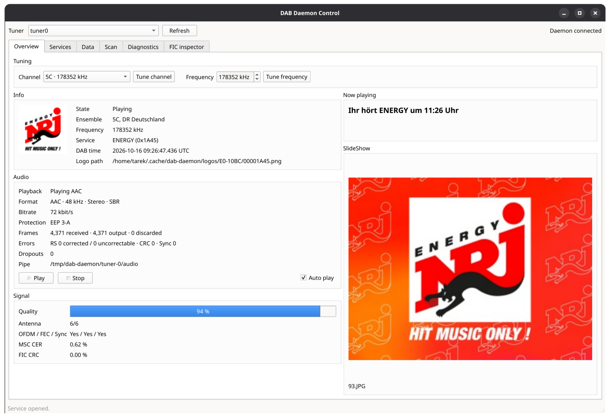
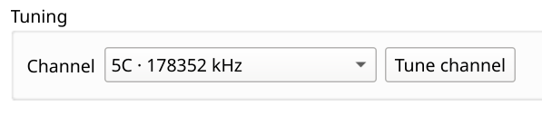
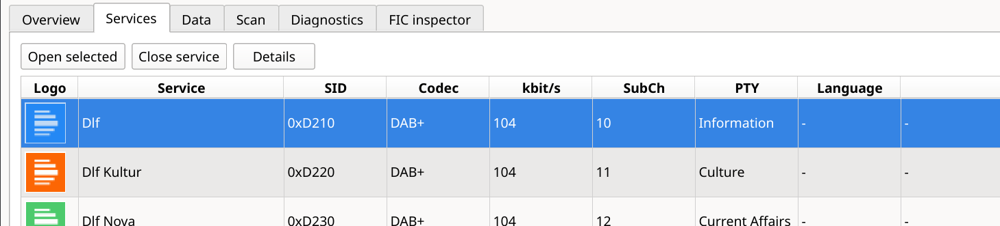

# DAB Daemon

A Linux DAB/DAB+ receiver daemon for the **wRadio C100**, a chip that can be found in many DAB dongles for Android radios.\
The daemon provides a D-Bus API for easy integration.

A demo application can be found in the `tools` folder.



## Features

- AAC and MPEG Layer II audio output via FIFO
- DLS radio text
- DL+ title, artist and album information
- Unicode service and ensemble names
- SlideShow images with categories, display timing and expiry metadata
- Journaline pages and menus
- Full and fast scanning
- Ensemble, service and component discovery
- SPI service information and program schedules
- Automatic SPI reception alongside audio
- Persistent ensemble and station database
- Station logos with caching
- TPEG service information, TEC traffic events and TFP traffic flow matrices
- TMC location references and raw TPEG transport frame inspection
- Alternative frequencies and ensembles
- Program type (PTY) and language metadata
- Linked services with hard and soft links
- Announcement signaling
- Emergency warning signaling
- Fast Information Data Channel reception
- Date and time
- Signal quality, antenna level and reception error statistics
- Audio decoder statistics, CRC errors and dropout counters
- FIC history with decoded fields and raw FIG data
- Packet data, MOT and SlideShow reception statistics
- Hardware access timeouts and asynchronous tuning
- D-Bus control, properties and change notifications
- Support for multiple tuners
- USB device discovery, hotplug handling and recovery
- Compile-time feature selection

---

## Getting started

[Build the daemon](docs/building.md), connect the receiver, then start the daemon:

```sh
./build/dab_deamon
```

[Prepare and activate a virtual environment](docs/gui-setup.md), then start the demo application in a second terminal:

```sh
python tools/dabctl.py
```

Select a channel/ensemble that you can receive in your area and click `Tune channel`:



Open the tab `Services` and double-click on a service:



The selected service should play after a short moment.

[More details](docs/gui-details.md) about the demo application

---

## D-Bus API

The daemon is available on the session bus as `de.multilan.dabdaemon`.\
Each receiver has its own tuner object for tuning, scans, broadcast data and audio output through a FIFO.
`Ensembles` keeps known stations across restarts and updates during scans and normal reception.
State changes are reported through property updates.

[API reference](docs/dbus-api.md) · [Data types](docs/dbus-types.md)
