# Demo Application Details

The demo application uses the daemon's public D-Bus API.

## Overview

Use the tuning controls to select a channel/ensemble or a specific frequency.\
`Seek Up` and `Seek Down` find the next received ensemble. `Stop Seek` cancels the search.

The overview tab shows:

- `Info`: Current station, ensemble, frequency, station logo and DAB time
- `Audio`: Playback controls, audio format, bitrate and decoder statistics
- `Signal`: Signal quality, antenna level, synchronization and reception errors
- `Now playing`: Song information and radiotext
- `SlideShow`: The current image and its metadata

Audio decoder statistics are shown when diagnostics is enabled in the daemon.
Audio is muted while switching stations. Playback starts with a short 15 ms fade-in.

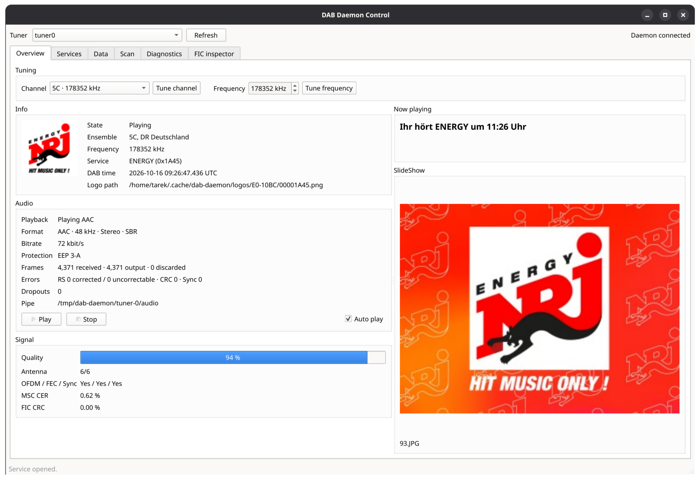

## Services

The `Services` tab lists the stations available on the current channel/ensemble.\
The list includes station logos, audio parameters, PTY, language and announcements.

The station list appears once reception is complete. The lower table lists components and data applications.

- Double-click a station or press `Open selected` to open it
- Press `Close service` to close the current service
- Press `Details` to see more information about the selected station

Station logos may take a while to arrive.

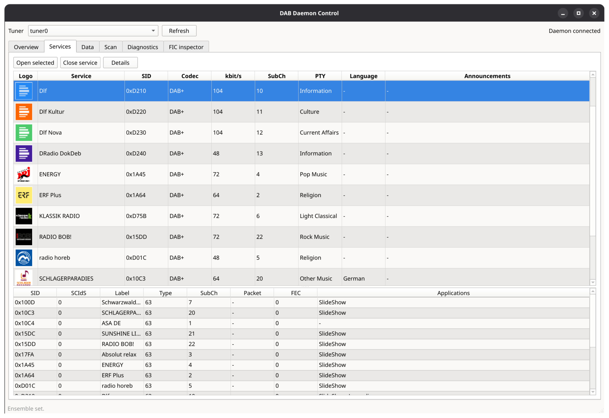

### Details

The details window shows the station's identity, logo, alternative frequencies and ensembles, and linked services.

In this example, `MDR JUMP`, a radio station available in 3 German states, is also offered on ensembles `9A` and `6B` besides the current `8B`.

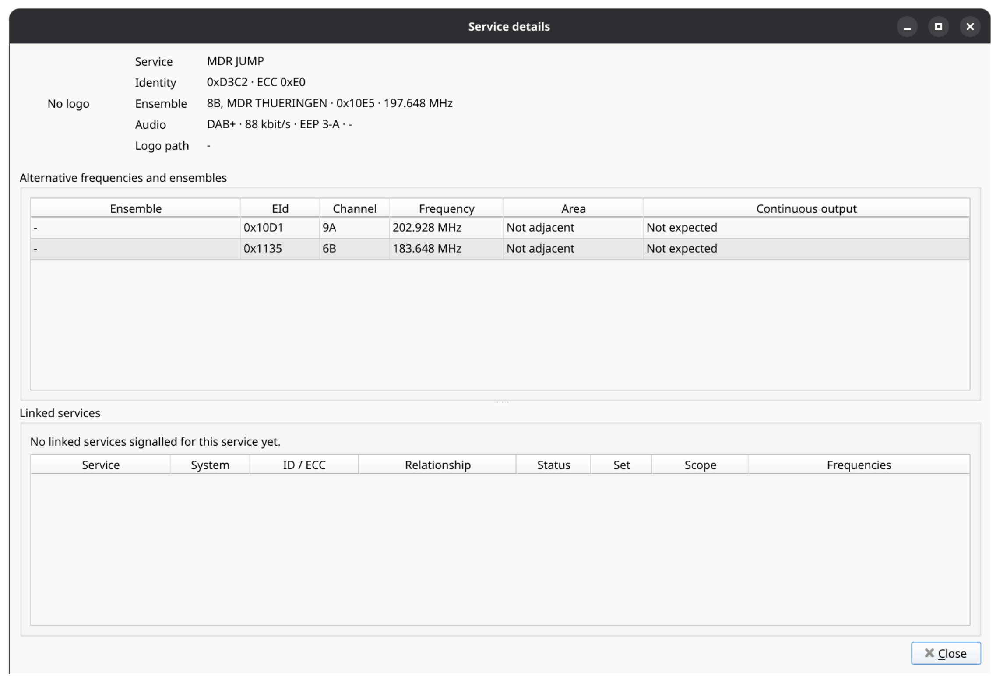

## Data

The `Data` tab contains SPI / EPG, Journaline and TPEG.\
The `Data path` box shows packet, MOT and SPI reception statistics.

### SPI

The `SPI / EPG` section displays station information, program schedules, program groups and received images for the current ensemble.

The upper table lists the SPI sources announced by the ensemble.\
It shows service and component IDs, transport types, subchannels, packet addresses and X-PAD application types.

Press `Refresh` to reload the information already received by the daemon.\
Schedules, descriptions and images arrive at different times during the broadcast cycle, so some entries may appear before others.

#### EPG

The `EPG` tab shows the program guide for the current ensemble.\
The table lists times, stations, program titles, duration, genre and description. Programs currently on air are marked `NOW`.

- Select a station or `All services` to filter the guide
- Choose a date or use `<` and `>` to change the day; `Today` returns to the current date
- Select a program to show its full description, language, ID and media references below the table

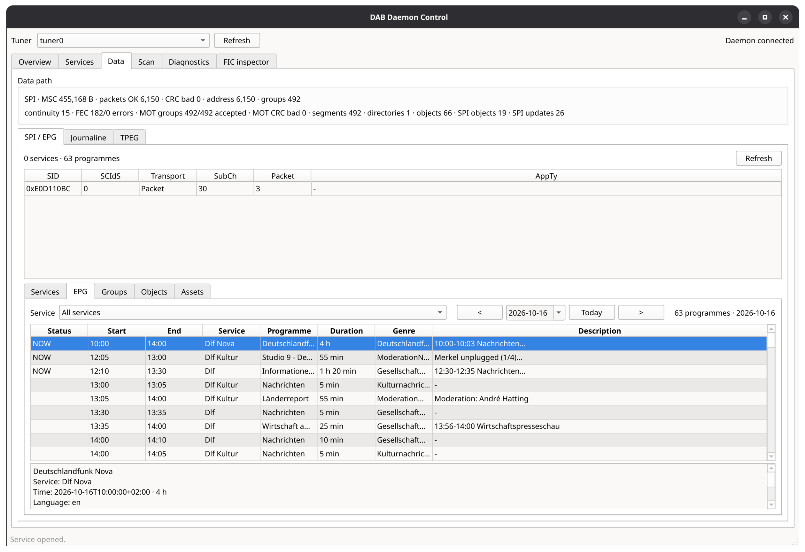

#### Services

The `Services` tab shows station information received through SPI:

- Service IDs and names
- Descriptions and genres
- Image paths or URLs

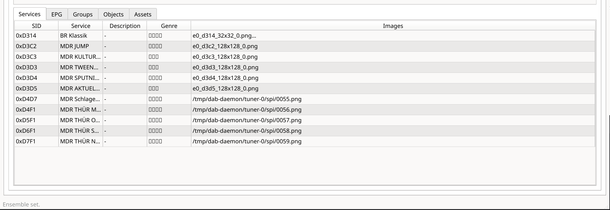

#### Groups

The `Groups` tab shows program groups, such as a series with multiple episodes or programs sharing a topic.\
Each entry contains the group ID, name and description.

1. Select a group to show its received programs, including programs from its subgroups
2. Select a program to show its details in the bottom pane

The program list covers all received dates. The station and day filters in the `EPG` tab do not apply here.

Groups are only listed when signaled by the broadcaster.\
A group may initially appear with only its ID until its name and description arrive.

#### Objects

The `Objects` tab shows received SPI objects with their transport ID, type/subtype, size, content name, MIME type, compression and profile.

SPI object types:

- `SI`: Service information
- `PI`: Program information
- `GI`: Group information

The `Decode` column shows the processing result, including entry counts or rejection reasons.

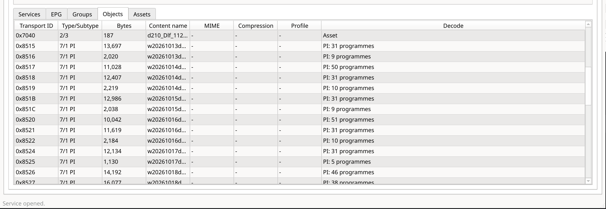

#### Assets

The `Assets` tab lists received station logos and other SPI images.\
Each entry shows the transport ID, content name, MIME type and local file path.

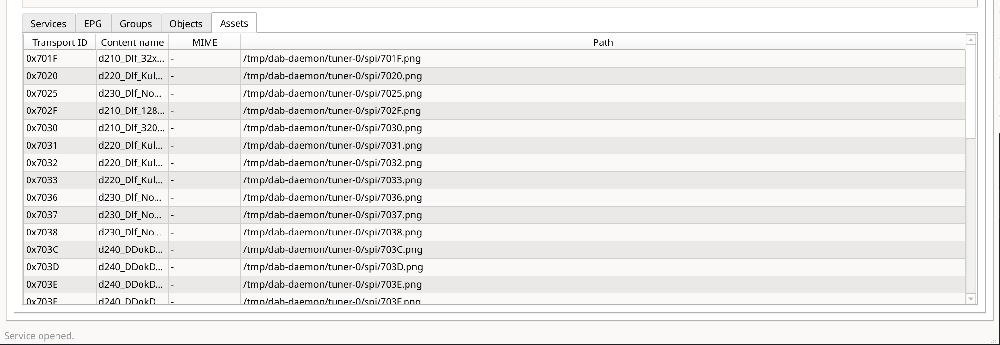

### Journaline

The `Journaline` tab shows broadcast text pages and menus.\
Select a page from the list or follow an internal link.

- `Home`: Open the signaled entry page
- `Back`: Return to the previous page
- `Forward`: Go forward through previously opened pages

This example uses Deutschlandfunk's Journaline service on ensemble `5C`.

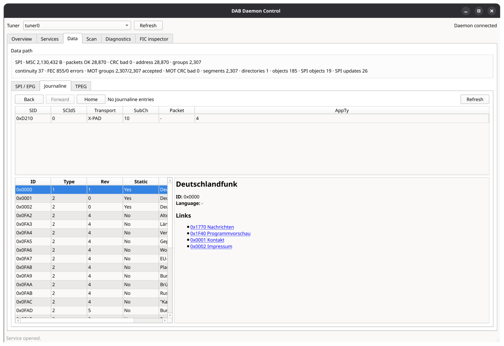

### TPEG

Select a TPEG transport and press `Receive selected` to receive its data.\
Press `Stop` to end reception and keep the received messages and frames. During radio reception, SPI can use the data channel again.

The TPEG section contains three tabs:

- `Messages`: TEC traffic events and TFP traffic flow data. Filter by application or search message text and fields. Select a message to see its decoded fields and raw bytes.
- `Services`: SNI service names and descriptions, component and content IDs, application versions, message counts and encryption indicators.
- `Frames`: Transport frames and component payloads, including encrypted or unsupported content. Select a frame to see its raw bytes.

Message updates replace the previous version. Canceled and expired messages remain marked in the list.

Decoded data includes:

- TEC: Traffic effects, causes, warning levels, timing, lengths, speeds and linked message IDs
- TFP: Flow matrices with time intervals, section offsets, levels of service and average speeds
- TMC locations: Location and table IDs, direction, extent and table version

TMC locations are shown as IDs. Translating them to road names requires the corresponding TMC location table.\
Other location methods and unhandled extensions are available as raw fields.

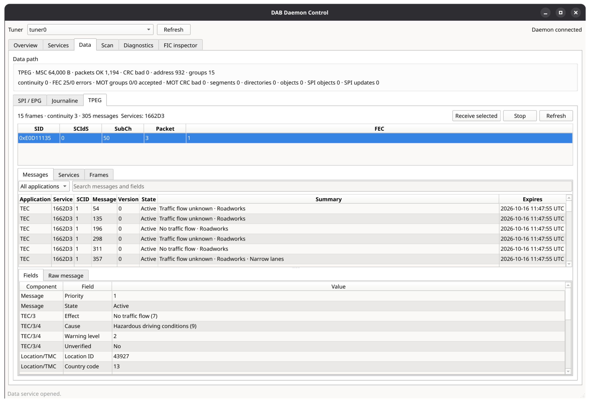

This example receives MDR TPEG alongside MDR JUMP on the MDR THÜRINGEN ensemble on channel `8B`.

The continuity counter can increase as this transport cycles its data-group index through 0–3.\
Valid frames are still decoded. CRC and malformed-content counters are shown separately.

## Scan

- `Fast scan`: Find ensembles
- `Full scan`: Find ensembles and collect their stations
- `Stop`: End the current scan

Full scan waits for station names and audio parameters. Incomplete ensemble
detection is retried once.

Results remain available after the scan.\
Click an ensemble or station to tune to it, including while a scan is still running.
Opening a station waits for `ServicesReady` and checks the current station list.

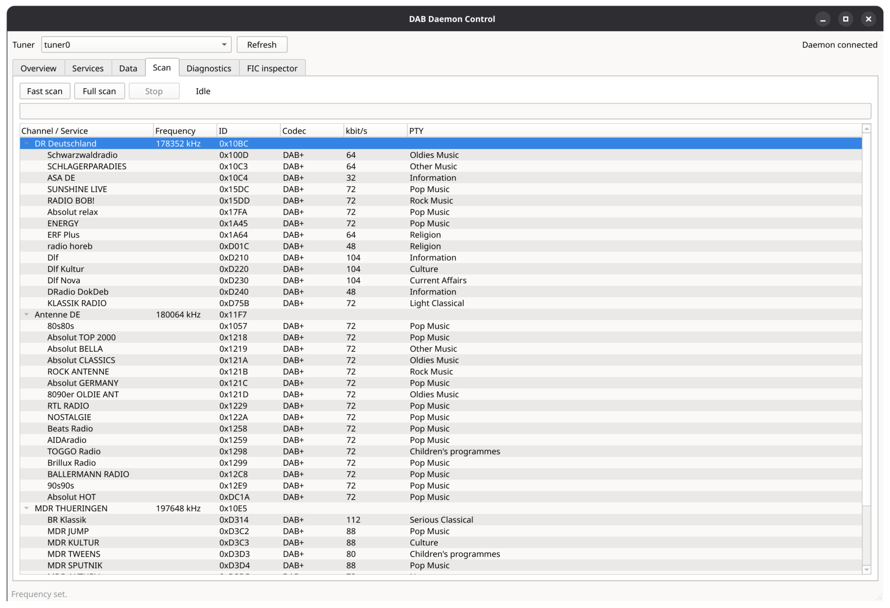

## Diagnostics

The `Diagnostics` tab shows:

- `Hardware`: USB errors, timeouts, last received data and recovery activity
- `Ensemble`: Ensemble identity, service count, time offset and configuration changes
- `FIC`: FIB and FIG counters, received FIG extensions, service following and announcements
- `SlideShow`: Data groups, image segments, objects and time to the first image
- `Emergency warnings (EWS)`: Received warning information
- `Fast Information Data Channel (FIDC)`: Received FIDC entries

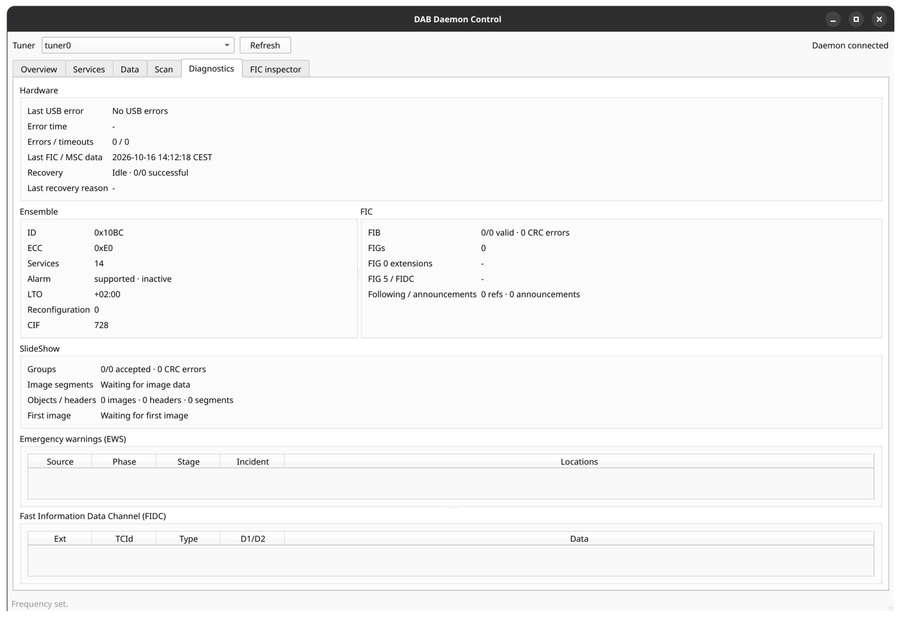

## FIC inspector

The `FIC inspector` shows received FIC records:

- Filter by FIG type/extension or search the records
- Select a row to see decoded fields, original bytes and changes from the previous matching record
- Press `Pause` to freeze the view; reception continues

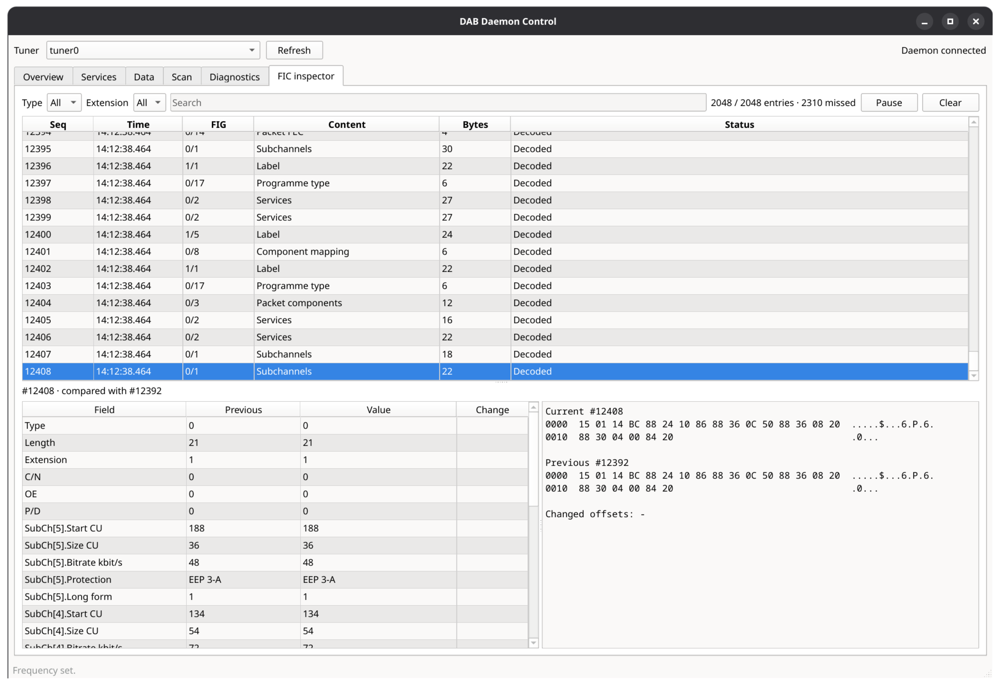
